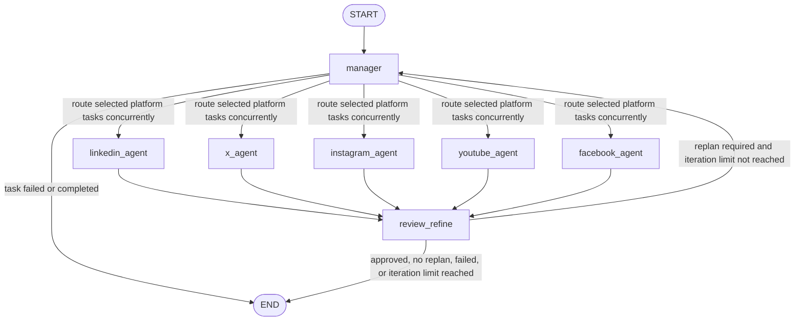
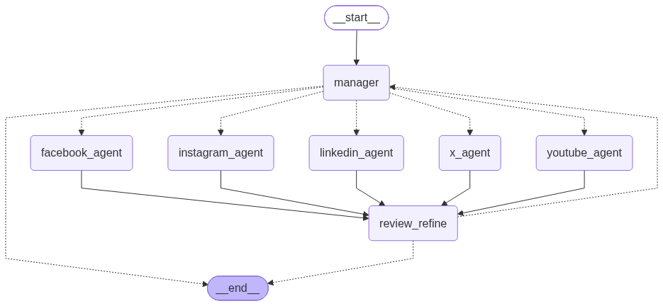

# Backend

## Overview

This directory contains the FastAPI service for generating platform-specific content drafts. It validates and screens requests, selects a model tier, coordinates planning and drafting with LangGraph, reviews the drafts, and returns the final result. It does not publish content to social platforms.

## Architecture



The compiled graph image is also generated at backend startup:



The manager's conditional route activates only the nodes named in `current_plan.platform_tasks`; when more than one platform is selected, those agent nodes run in parallel. Every selected agent converges at `review_refine`. During a refinement pass, the manager targets only platforms marked as needing refinement. The API sets `max_iterations` to `1`, so the graph allows at most one refinement pass after the initial drafts.

### Request flow

1. `POST /content/generate` validates the request schema and rejects empty content. Input guardrails block certain requests for actionable explosive instructions or fabricated/harmful allegations.
2. A single-platform request is classified using the `complexity_prompt`. Classification uses the simple tier first and falls back to the complex tier if needed. A request for multiple platforms skips classification and uses the complex tier.
3. The LangGraph manager creates a task for each requested platform. Platform agents run concurrently, use a shared Langfuse-managed prompt with platform-specific guidance, and store their latest drafts in workflow state.
4. The reviewer checks generated drafts against the source, audience, plan, and configured quality threshold. If a draft needs work and the iteration limit allows it, the manager replans only for unapproved platforms and agents receive review feedback plus their existing draft.
5. The workflow returns the latest draft for every requested platform. Output guardrails check drafts before the API responds. A fixed refusal message is returned if a guardrail rejects input or output.

The API currently allows one refinement pass after the initial drafting pass. Workflow state also tracks plans, execution history, review history, per-platform status and feedback, and completion or failure status.

### Main components

| Path | Responsibility |
| --- | --- |
| `app/main.py` | Creates the FastAPI app, configures CORS, request logging, error handlers, graph startup, and Langfuse shutdown flushing. |
| `api/routes.py` | Implements health and content-generation routes, validates platform names, chooses model tier, invokes the graph, and applies request/response guardrails. |
| `schemas/content.py` | Defines request and response models. |
| `graph/builder.py` | Builds and compiles the LangGraph workflow and renders `content_graph.png` on startup. |
| `graph/routing.py` | Maps platform names to agent nodes and routes between planning, review, and workflow completion. |
| `state/content_state.py` | Defines the shared workflow state and its merge behavior. |
| `agents/manager.py` | Creates structured platform tasks and targets unapproved platforms during refinement. |
| `agents/*_agent.py` | Adds platform-specific voice and format requirements for LinkedIn, X, Instagram, YouTube, and Facebook. |
| `agents/common_implementation.py` | Builds platform prompts, invokes the configured model, and saves drafts in workflow state. |
| `agents/review_refine.py` | Scores drafts, records feedback and approval status, and decides whether another cycle is required. |
| `config/` and `observability.py` | Configure model aliases, complexity assessment, safety checks, Langfuse prompt access, and tracing. |

## API

Interactive API documentation is available at `/docs` when the service is running; the OpenAPI schema is at `/openapi.json`.

### `GET /health`

Checks that the API process is running. Returns `200` with a status and message. It does not check connectivity to Langfuse, the LiteLLM proxy, or model providers.

### `POST /content/generate`

Creates and reviews a draft for each requested platform.

Example request:

```json
{
  "content": "A source idea or text to adapt",
  "platforms": ["linkedin", "instagram"],
  "audience": "small business owners"
}
```

`content` is required and limited to 12,000 characters. `platforms` defaults to `linkedin`, `x`, and `instagram`; supported names are `linkedin`, `x`, `instagram`, `youtube`, and `facebook`. `audience` defaults to `general` and is limited to 180 characters. If `audience` is omitted and the source has a plainly labeled `Audience:` or `Target audience:` line, that value is used for drafting; otherwise the default applies. If the caller supplies an audience that differs from a plainly labeled audience in the source, the supplied audience is used and the response summary calls out the discrepancy.

Successful response:

```json
{
  "processed_content": [
    {"platform": "linkedin", "processed_content": "..."},
    {"platform": "instagram", "processed_content": "..."}
  ],
  "message": "Your LinkedIn and Instagram drafts are ready. You can refine the details and regenerate anytime."
}
```

Successful responses include a user-facing summary in `message`, shown after the drafts in the UI. It confirms which drafts were created and can mention material missing or unavailable details. If the source clearly requests more platforms than the caller selected, the API still creates drafts only for the selected platforms and explains how to select the remaining platforms. The API supplements the manager's scope flag with a deterministic check for explicit all-platform or each-agent instructions and actionable requests naming multiple platforms. A supplied audience that conflicts with a plainly labeled audience in the source is also called out; the supplied audience is used for the drafts. If the manager cannot proceed because requirements conflict, the API returns the clarification in `message` with an empty `processed_content` array. Guardrail refusals use the same empty-draft response shape. Validation failures return `422`; complexity assessment timeout returns `504`, complexity service failure returns `503`, and workflow failures or missing final results return `500`. The API uses generic error messages for request validation and unexpected failures; details are written to backend logs.

## Setup

### Prerequisites

- Python 3.13 or newer and [`uv`](https://docs.astral.sh/uv/).
- A running LiteLLM proxy configured with the model aliases below.
- An Ollama server with `llama3.2` available for the simple tier, and Azure OpenAI credentials/deployment access for the complex tier.
- A Langfuse project with the required prompts published under the `production` label.

### Install dependencies

From this directory:

```bash
uv sync
```

### Configure environment

Create `backend/.env` (or export the variables in the shell used to start the service):

```dotenv
AZURE_OPENAI_ENDPOINT=https://<resource>.openai.azure.com/
AZURE_OPENAI_API_KEY=<azure-api-key>
AZURE_OPENAI_API_VERSION=<api-version>
LANGFUSE_PUBLIC_KEY=<langfuse-public-key>
LANGFUSE_SECRET_KEY=<langfuse-secret-key>
LANGFUSE_BASE_URL=https://cloud.langfuse.com
LANGFUSE_ENABLED=true

# Optional model alias and timeout overrides
LITELLM_SIMPLE_MODEL_ALIAS=simple-tier
LITELLM_COMPLEX_MODEL_ALIAS=complex-tier
LITELLM_REVIEW_MODEL_ALIAS=complex-tier
LLM_CALL_TIMEOUT_SECONDS=60

# Optional comma-separated browser origins for the API
FRONTEND_ORIGINS=http://localhost:5173,http://127.0.0.1:5173
```

The included `config/litellm_config.yaml` defines `simple-tier` as Ollama `llama3.2` at `http://localhost:11434` and `complex-tier` as Azure `gpt-5-mini`, using the Azure endpoint, key, and API version above. The API calls the LiteLLM OpenAI-compatible endpoint at `http://localhost:4000/v1`.

### Configure Langfuse prompts

The backend fetches and compiles these text prompts using the `production` label:

| Prompt name | Used by | Template variables supplied by backend |
| --- | --- | --- |
| `complexity_prompt` | Single-platform model-tier classification | `content` |
| `manager_prompt` | Request analysis, task planning, and refinement planning | `content`, `audience`, `iteration`, `is_refinement`, `selected_platforms`, `platform_tasks` |
| `common_implementation` | Platform draft generation and refinement | `platform`, `platform_guidance`, `audience`, `source`, `task`, `is_refinement`, `feedback`, `existing_draft` |
| `review_refine_prompt` | Quality review and approval/refinement decision | `source`, `audience`, `threshold`, `plan`, `drafts` |

The manager uses `manager_prompt` for all requests so it can assess missing details, platform scope, and contradictory instructions consistently. The backend validates the manager's structured response and supplements its platform-scope flag with a deterministic check of explicit all-platform instructions and actionable requests naming multiple platforms. The response summary is assembled by the API after drafting; the manager prompt should return planning metadata and platform tasks, not user-facing summary text. Platform agents still use the selected complexity tier. Langfuse is also used for tracing when enabled. Prompt retrieval still requires valid Langfuse credentials and configured prompts.

### Run the services

Start Ollama and ensure the configured model is available. Start the LiteLLM proxy from `backend` in one terminal:

```bash
uv run litellm --config config/litellm_config.yaml --port 4000
```

Start the API from `backend` in another terminal:

```bash
uv run uvicorn app.main:app --host 0.0.0.0 --port 8000 --reload
```

The API is then available at `http://localhost:8000`, with interactive docs at `http://localhost:8000/docs`. The application compiles the workflow on startup, writes a graph image to `backend/content_graph.png`, and logs to the console and `backend/logs/app.log`.

## Model and observability behavior

- Single-platform requests use the classifier result to choose the simple or complex generation alias. If the simple-tier classifier call fails, classification is retried with the complex alias.
- Multi-platform requests always use the complex generation alias. Reviews use `LITELLM_REVIEW_MODEL_ALIAS`, which defaults to the complex alias.
- The LiteLLM proxy config controls the provider behind each alias. The API client uses a local proxy URL and a placeholder API key; provider credentials are read by LiteLLM from the environment.
- Langfuse manages prompts and, when `LANGFUSE_ENABLED` is true (the default), records traces. Set it to `false` to disable tracing; prompt access remains part of generation.
- Backend logging includes request timing and workflow metadata. Prompts and source/draft text are generally not logged by the generation helpers.

## Error handling and limits

- Request schema and unsupported-platform errors return `422`.
- Complexity timeouts return `504`; complexity service errors return `503`.
- Generation timeouts return `504`; other graph errors or absent final results return `500`.
- An empty content string is rejected. Input and generated-output guardrails use deterministic pattern checks for specific harmful requests; they are a safety layer, not a guarantee of factual accuracy.
- The graph makes at most one refinement cycle after initial generation. It returns the latest available drafts when that limit is reached.
- CORS permits the origins in `FRONTEND_ORIGINS`; by default, local Vite origins on ports `5173` and `4173` are allowed. Only `GET`, `POST`, and `OPTIONS` are allowed by the middleware.

## Backend directory map

```text
backend/
|-- app/          FastAPI application startup and middleware
|-- api/          HTTP routes
|-- schemas/      Request and response schemas
|-- graph/        LangGraph construction and routing
|-- state/        Shared graph state
|-- agents/       Manager, platform draft agents, and reviewer
|-- config/       Model, prompt, complexity, and safety configuration
|-- callbacks/    Langfuse callback integration
`-- logs/         Runtime application log
```
