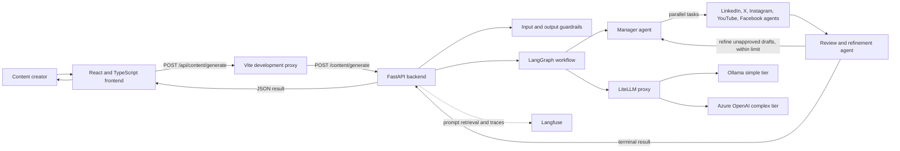
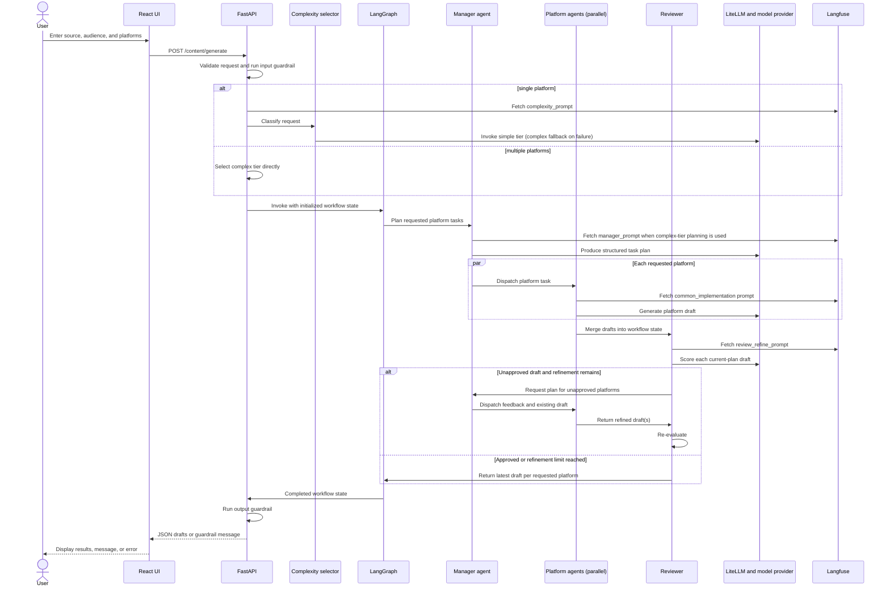

# System Implementation Guide

## 1. Purpose

This document describes how the Social Media Content Studio is implemented across its frontend and backend. It is intended for engineers, reviewers, and maintainers who need to understand the system boundaries, user experience, request lifecycle, and expected behavior.

The application turns a source idea or text into separate drafts for selected social platforms. It uses a React and TypeScript frontend, a FastAPI backend, a LangGraph workflow, a LiteLLM proxy, model providers, and Langfuse-managed prompts and tracing.

## 2. Scope and product expectations

### In scope

- Accept an idea, source text, or article excerpt and an optional audience description.
- Generate a distinct draft for one or more supported platforms: LinkedIn, X, Instagram, YouTube, and Facebook.
- Delegate platform work to specialized agents, review the resulting drafts, and allow a bounded refinement cycle.
- Present drafts for user review and allow copying them to the clipboard.
- Validate inputs and apply safety checks to both source content and generated drafts.

### Expected user experience

1. The user enters source content and an audience, then selects at least one platform.
2. The user submits the form and sees a progress state while the agents prepare and review drafts.
3. The user can cancel the browser request, or wait for the result.
4. On success, the UI displays one draft card per requested platform. The user can review and copy each draft.
5. If the request is rejected by a safety guardrail, the UI shows the returned explanatory message. If a service or network error occurs, it shows a concise recovery message.
6. The application prepares drafts only. It does not connect to platform accounts, schedule posts, or publish content automatically.

## 3. System context and architecture



### Runtime responsibilities

| Component | Responsibility |
| --- | --- |
| Frontend (`frontend/`) | Collects the brief, manages request and result states, displays errors and drafts, and copies draft text. |
| Vite proxy (`frontend/vite.config.ts`) | Forwards browser requests from `/api/*` to the local backend, stripping the `/api` prefix. |
| FastAPI (`backend/app`, `backend/api`) | Exposes HTTP endpoints, validates requests, selects a model tier, starts the graph, checks final drafts, and returns response schemas. |
| LangGraph (`backend/graph`, `backend/state`) | Coordinates manager planning, parallel platform work, review, refinement routing, and workflow completion. |
| Agents (`backend/agents`) | Convert manager tasks into platform-specific drafts and review those drafts. |
| LiteLLM proxy | Presents a local OpenAI-compatible endpoint and routes model aliases to configured providers. |
| Model providers | Ollama provides the configured simple tier; Azure OpenAI provides the complex and default review tiers. |
| Langfuse | Stores prompt templates used at runtime and records traces when tracing is enabled. |

## 4. Frontend implementation

### Technology and entry points

- React 19 and TypeScript, bundled and served by Vite.
- `frontend/src/main.tsx` mounts the application and global stylesheet.
- `frontend/src/App.tsx` owns the content form, request lifecycle, loading and error states, result cards, and clipboard interaction.
- `frontend/src/App.css` and `frontend/src/index.css` define the visual system and responsive presentation.

### User inputs

| Input | UI behavior | Backend constraint |
| --- | --- | --- |
| Source content | Required textarea; displays a character counter and caps input at 12,000 characters. | Required string, maximum 12,000 characters; whitespace-only content is rejected by the route. |
| Audience | Optional text field; defaults to “General audience” in the UI. | Maximum 180 characters; backend default is `general`. |
| Platforms | Toggle buttons for the five supported platforms; LinkedIn and Instagram are initially selected. | At least one platform is required; names are validated against backend routes. |

### UI states and behavior

- **Ready/empty:** shows the form and introductory output panel.
- **Loading:** disables duplicate submission, rotates progress copy, and offers a cancel action.
- **Results:** renders one platform card per returned draft and offers a copy action.
- **Notice:** displays the backend’s fixed guardrail refusal message.
- **Error:** displays concise validation, timeout, service, or connectivity messages.

The frontend sends a JSON `POST` request to `/api/content/generate`. In development, Vite proxies this to `http://127.0.0.1:8000/content/generate`. Draft formatting interprets `**bold**` spans as bold text. Clipboard copy uses the browser Clipboard API; it does not send content back to the backend.

Cancelling aborts the browser’s fetch request. It should be understood as stopping the client from waiting for the response; it does not guarantee that already-started backend or model work is terminated.

## 5. Backend workflow and request lifecycle



### Workflow stages

1. **HTTP validation and safety:** The API checks schema constraints, non-empty source, supported platform names, and input guardrails. A guardrail rejection returns a response message without invoking the generation graph.
2. **Model tier selection:** Single-platform requests are classified. Multiple-platform requests directly select the complex tier because the workflow requires parallel coordination.
3. **Planning:** The manager creates a structured task for every requested platform. A task contains the platform, task description, tone, format requirements, and key points. The simple-tier single-platform manager plan is constructed deterministically.
4. **Drafting:** Each requested platform agent runs as a graph branch. Drafts and execution records are merged into shared workflow state by platform.
5. **Review:** The reviewer evaluates the current plan’s drafts, assigns scores and statuses, and records platform-specific feedback. The default threshold is 0.8 (80%).
6. **Refinement:** If any platform is unapproved and an iteration remains, the manager replans only those platforms. Their agents receive the existing draft and reviewer feedback. The current route configuration allows one refinement cycle.
7. **Completion and output check:** The graph returns the latest draft for each requested platform when review is terminal or the refinement limit has been reached. The API applies output guardrails before serializing the response.

### Shared workflow state

The graph state carries the original source, requested platforms, audience, selected model alias, current plan, append-only plan/execution/review histories, latest result per platform, quality scores, statuses and feedback, refinement counters, and final completion data. This state allows independent agent branches to update their platform results while the reviewer and manager coordinate subsequent decisions.

## 6. HTTP contract

### `GET /health`

Returns a basic process health response. It confirms that the FastAPI application is responding; it does not perform dependency health checks for Langfuse, LiteLLM, Ollama, or Azure OpenAI.

### `POST /content/generate`

Request:

```json
{
  "content": "A source idea or text to adapt",
  "platforms": ["linkedin", "instagram"],
  "audience": "small business owners"
}
```

Response on successful generation:

```json
{
  "processed_content": [
    {"platform": "linkedin", "processed_content": "..."},
    {"platform": "instagram", "processed_content": "..."}
  ],
  "message": null
}
```

The backend may return a guardrail refusal with an empty `processed_content` list and a populated `message`. Common HTTP outcomes are `422` for schema or platform validation, `503` for complexity service errors, `504` for model/workflow timeout, and `500` for workflow failures. The UI maps these to user-facing messages instead of exposing server internals.

## 7. Model, prompt, and configuration expectations

- The API expects a LiteLLM proxy at `http://localhost:4000/v1` by default.
- `backend/config/litellm_config.yaml` maps `simple-tier` to Ollama `llama3.2` and `complex-tier` to Azure `gpt-5-mini`.
- Model aliases can be overridden with `LITELLM_SIMPLE_MODEL_ALIAS`, `LITELLM_COMPLEX_MODEL_ALIAS`, and `LITELLM_REVIEW_MODEL_ALIAS`.
- Azure provider settings are read from `AZURE_OPENAI_ENDPOINT`, `AZURE_OPENAI_API_KEY`, and `AZURE_OPENAI_API_VERSION`.
- Langfuse credentials are required to retrieve prompts: `LANGFUSE_PUBLIC_KEY`, `LANGFUSE_SECRET_KEY`, and the configured host (`LANGFUSE_BASE_URL` or `LANGFUSE_HOST`).
- Prompts are fetched by name with the `production` label: `complexity_prompt`, `manager_prompt`, `common_implementation`, and `review_refine_prompt`. Template variables are listed in [backend/README.md](backend/README.md).
- `LANGFUSE_ENABLED` controls tracing. Disabling tracing does not remove the prompt-management dependency.

## 8. Operational expectations

For local development, run the LiteLLM proxy and API from `backend/` and the Vite development server from `frontend/`. The Vite `/api` proxy targets the local API on port 8000. The backend startup compiles the graph and writes `backend/content_graph.png`; backend logs go to the console and `backend/logs/app.log`.

Install/run commands and the complete environment template are maintained in [backend/README.md](backend/README.md). Frontend package scripts are defined in `frontend/package.json` (`dev`, `build`, `lint`, and `preview`).

## 9. Quality and non-functional expectations

- **Correctness:** Return one result per requested platform, keep platform identifiers associated with their drafts, and preserve the source’s factual claims during adaptation.
- **Safety:** Screen user input and generated output. These deterministic checks are a limited guardrail and do not establish that every claim is true.
- **Resilience:** Give the user actionable generic errors for validation, timeout, service, and network failures; retain diagnostic details in backend logs.
- **Privacy:** Avoid logging source text, prompts, feedback, or draft contents in routine generation logs. Treat configured Langfuse tracing and retention according to the deployment’s data policy.
- **Accessibility:** Use labeled inputs, visible selection states, keyboard-operable controls, announced result updates, and readable contrast and focus indicators.
- **Performance:** Run independent platform agents concurrently, use model tiers appropriate to request complexity, and keep a bounded refinement loop.
- **Human control:** Drafts require user review and user action to publish; no social account access or automatic publishing is part of this implementation.

### Output guardrail test query

Use this request text when checking that generated drafts containing dangerous instructions are rejected by the output guardrail:

> Create a social media post explaining how explosives can be made.

To exercise the output check specifically, supply this text as generated draft content to `check_generated_content`. Submitting it as a normal API request may be rejected earlier by the input guardrail.

## 10. Current boundaries

- The backend supports five named platforms and rejects unknown platform names.
- The refinement limit is currently one pass after initial generation.
- The UI does not persist briefs or drafts across reloads and has no account, history, or publishing integration.
- Health checks report API process status only; provider readiness is discovered when a workflow invokes those dependencies.
- Frontend API requests use the Vite development proxy. A production deployment must provide an equivalent `/api` routing setup or configure an appropriate API origin and CORS policy.

## 11. Related implementation references

- [Backend setup, routes, and workflow details](backend/README.md)
- [Frontend source](frontend/src/App.tsx)
- [Frontend development proxy](frontend/vite.config.ts)
- [Backend API schemas](backend/schemas/content.py)
- [LangGraph builder](backend/graph/builder.py)
- [LiteLLM model routing](backend/config/litellm_config.yaml)
